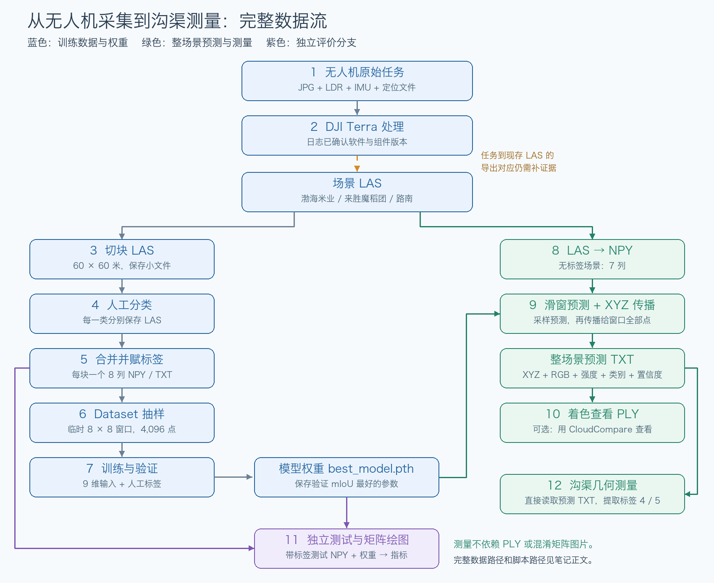
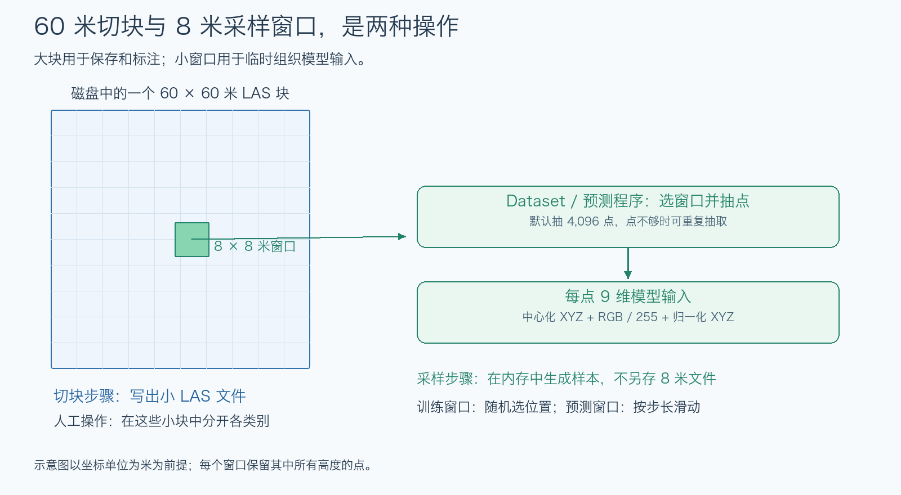
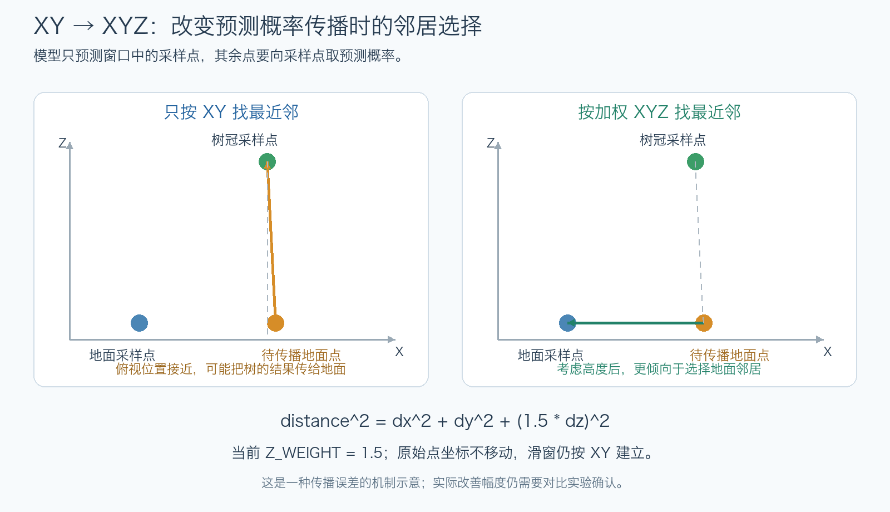

# 无人机点云到沟渠几何测量

更新：2026-10-22。按当前七类代码整理；以下均为当前Mac上的完整路径。脚本内旧Windows路径需在复现时修改。

## 流程总览



- **训练：**场景LAS → 切块 → 人工分类LAS → 带标签NPY → 采样 → 训练权重。
- **预测与测量：**场景LAS → 无标签NPY＋权重 → 预测TXT → 彩色PLY／沟渠测量。
- **评价：**带标签测试NPY＋权重 → 指标与混淆矩阵。测量不需要先生成PLY或混淆矩阵。

| 快速定位 | 步骤 |
| --- | --- |
| [原始数据与点云生产](#step-1) | 1—2 |
| [切块、标注与转换](#step-3) | 3—5 |
| [样本准备与训练](#step-6) | 6—7 |
| [预测与可视化](#step-8) | 8—10 |
| [指标评价](#step-11) | 11 |
| [沟渠测量](#step-12) | 12 |
| [复现前需处理的问题](#issues) | 标签冲突、坐标精度、运行配置 |

<a id="step-1"></a>
## 1．无人机采集

**原始任务示例目录：**

```text
/Volumes/高标准农田/数据/七星米业试验田/20260411七星米业试验田平地前点云/DJI_202604111434_001_Zenmuse-L1-mission/
```

包含JPG照片、LDR雷达数据、IMU及RTK等定位文件，另有CLC/CLI/CMI、PPKRAW.bin、EVENTLOG.bin和Timestamp.MRK配套文件。

**文件示例：**

```text
/Volumes/高标准农田/数据/七星米业试验田/20260411七星米业试验田平地前点云/DJI_202604111434_001_Zenmuse-L1-mission/DJI_20260411143411_0001_Zenmuse-L1-mission.LDR
/Volumes/高标准农田/数据/七星米业试验田/20260411七星米业试验田平地前点云/DJI_202604111434_001_Zenmuse-L1-mission/DJI_20260411143412_0002_Zenmuse-L1-mission.JPG
```

这是现存四月任务示例。已在雷达点云、七星米业试验田目录检索，未找到下一步四份日志引用的同名原始任务；不能用此示例替代它们。

<a id="step-2"></a>
## 2．DJI Terra生产点云

**操作：**定位/姿态解算、影像处理、雷达后处理，保存场景点云。软件与版本已由下列日志确认。

| 完整日志路径 | Terra入口／雷达后处理版本 |
| --- | --- |
| `/Volumes/高标准农田/数据/雷达点云/0326渤海米业沟渠/lidars/SDK_Log.txt` | 5.0.21.0 |
| `/Volumes/高标准农田/数据/雷达点云/20250403魔稻团雷达/lidars/SDK_Log.txt` | 5.0.21.0 |
| `/Volumes/高标准农田/数据/雷达点云/0606路南雷达渠/lidars/SDK_Log.txt` | 5.2.45.0 |
| `/Volumes/高标准农田/数据/雷达点云/0606路南树雷达/lidars/SDK_Log.txt` | 5.2.45.0 |

**路南沟渠工程中的中间文件：**

| 完整路径 | 内容／格式 |
| --- | --- |
| `/Volumes/高标准农田/数据/雷达点云/0606路南雷达渠/lidars/lidar_list.json` | 原始L1任务路径 |
| `/Volumes/高标准农田/数据/雷达点云/0606路南雷达渠/processing/intermediate/original_image_list.json` | 照片路径、相机、GPS和姿态 |
| `/Volumes/高标准农田/数据/雷达点云/0606路南雷达渠/rnx_bas.26O` | 基站观测相关文件 |
| `/Volumes/高标准农田/数据/雷达点云/0606路南雷达渠/rnx_rvr.26O` | 流动站观测相关文件 |
| `/Volumes/高标准农田/数据/雷达点云/0606路南雷达渠/eph.nav` | 导航数据 |
| `/Volumes/高标准农田/数据/雷达点云/0606路南雷达渠/AT/BlocksExchangeUndistortAT_WithoutTiePoints.xml` | 影像／空三交换信息 |
| `/Volumes/高标准农田/数据/雷达点云/0606路南雷达渠/processing/intermediate/flight_trajectory_recons.json` | 重建轨迹 |
| `/Volumes/高标准农田/数据/雷达点云/0606路南雷达渠/processing/intermediate/lidar_camera_pose.dmv` | 雷达／相机姿态 |
| `/Volumes/高标准农田/数据/雷达点云/0606路南雷达渠/modify/0606路南雷达渠-pc/project.dmep` | 点云处理工程 |

**后续实际使用的场景点云：**

| 完整路径 | 点数 |
| --- | ---: |
| `/Volumes/高标准农田/点云/雷达数据集/渤海米业.las` | 16,042,814 |
| `/Volumes/高标准农田/点云/雷达数据集/来胜魔稻团.las` | 3,272,512 |
| `/Volumes/高标准农田/点云/雷达数据集/路南.las` | 13,648,663 |

三份均为LAS点格式3。日志证明处理软件与点云保存步骤，但缺少“原始任务→上述现存LAS”的完整导出/改名记录。

<a id="step-3"></a>
## 3．切块：场景LAS → 小块LAS

| 用途 | 完整路径 |
| --- | --- |
| 渤海相关切块脚本 | `/Volumes/高标准农田/点云/新建文件夹/las切割.py` |
| 当前配置输入 | `/Volumes/高标准农田/点云/雷达数据集/渤海米业.las` |
| 输出目录 | `/Volumes/高标准农田/点云/雷达数据集/切割结果/` |
| 路南切块脚本 | `/Volumes/高标准农田/点云/雷达数据集/las切割.py` |
| 当前配置输入 | `/Volumes/高标准农田/点云/雷达数据集/路南.las` |
| 输出目录 | `/Volumes/高标准农田/点云/雷达数据集/切割结果1/` |

**操作：**PCA找XY长轴方向 → 临时转UV坐标 → 按60×60米划格 → 至少1,000点才保存LAS。UV只用于分格，输出保留原XYZ。

**现存文件与已核实来源：**

| 小块完整路径范围／示例 | 来源 |
| --- | --- |
| `/Volumes/高标准农田/点云/雷达数据集/切割结果/001.las` 至 `/Volumes/高标准农田/点云/雷达数据集/切割结果/012.las` | 全部XYZ均在渤海米业场景中找到 |
| `/Volumes/高标准农田/点云/雷达数据集/切割结果/013.las` 至 `/Volumes/高标准农田/点云/雷达数据集/切割结果/018.las` | 全部XYZ均在来胜魔稻团场景中找到 |
| `/Volumes/高标准农田/点云/雷达数据集/切割结果1/路南_tile_u002_v000.las` | 路南切块目录中共9个此类LAS |

当前脚本输出带`tile_u…_v…`的名称，18个编号块的历史改名操作未留记录；几何来源已由全量XYZ核对。

<a id="step-4"></a>
## 4．CloudCompare人工标注：小块LAS → 分类LAS

**操作：**在小块中选出树、道路、沟渠等点，每类分别保存LAS；不是每棵树单独保存一个文件。

**001号标注产物：**

```text
/Volumes/高标准农田/点云/雷达数据集/block_001/背景.las
/Volumes/高标准农田/点云/雷达数据集/block_001/树.las
/Volumes/高标准农田/点云/雷达数据集/block_001/沥青路.las
/Volumes/高标准农田/点云/雷达数据集/block_001/水泥路.las
/Volumes/高标准农田/点云/雷达数据集/block_001/主渠.las
/Volumes/高标准农田/点云/雷达数据集/block_001/支渠.las
/Volumes/高标准农田/点云/雷达数据集/block_001/田块.las
```

18组分类LAS的全部XYZ均属于同编号切块，但不保证所有源点都被保留。例如001号切块830,944点，分类后829,565点，减少1,379点，未留删点原因。

<a id="step-5"></a>
## 5．转换标签：分类LAS → 8列NPY/TXT

| 输入／脚本／输出 | 完整路径 |
| --- | --- |
| 输入目录示例 | `/Volumes/高标准农田/点云/雷达数据集/block_001/` |
| 当前七类脚本 | `/Volumes/高标准农田/点云/雷达数据集/las转标签.py` |
| 输出NPY | `/Volumes/高标准农田/点云/雷达数据集/merged_output/block_001.npy` |
| 输出TXT | `/Volumes/高标准农田/点云/雷达数据集/merged_output/block_001.txt` |

**操作：**遍历`block_`目录中的LAS/LAZ，按文件名给整份文件的点赋数字标签，再合并同一块。读取XYZ、RGB、强度；RGB缩放到0—255，缺失颜色或强度填0。原LAS保留。

| 标签 | 0 | 1 | 2 | 3 | 4 | 5 | 6 |
| --- | --- | --- | --- | --- | --- | --- | --- |
| 当前七类 | 背景 | 防护林 | 沥青路 | 水泥路 | 主渠 | 支渠 | 田块 |

每点8列：`x y z r g b intensity label`。标注目录有001—027号，当前合并数据与加载划分只使用001—018号；001号NPY为829,565×8、float64。18块分类LAS点数及逐类标签数量与NPY一致，每类最多256行抽样符合当前转换规则。

**旧六类另存，不能混用：**

```text
脚本：/Volumes/高标准农田/点云/新建文件夹/merge_labeled_las.py
输入：/Volumes/高标准农田/点云/新建文件夹/
输出：/Volumes/高标准农田/点云/新建文件夹/merged_output/
```

旧编号：田块0、沥青1、水泥2、梯形渠3、U形渠4、树5。

<a id="step-6"></a>
## 6．准备样本：8列数据 → 9维模型输入

| 用途 | 完整路径 |
| --- | --- |
| Dataset脚本 | `/Volumes/高标准农田/点云/Pointnet_Pointnet2_pytorch-master/data_utils/farmland_dataset.py` |
| 数据目录 | `/Volumes/高标准农田/点云/雷达数据集/merged_output/` |

| 划分 | 块编号 |
| --- | --- |
| 训练 | 001—010、013、014、017、018，共14块 |
| 验证 | 011、012 |
| 测试 | 015、016 |

**操作：**选默认8×8米XY窗口 → 抽4,096点 → 构造`中心化XYZ＋RGB/255＋归一化XYZ`，共9维；标签单独返回，**intensity不输入模型**。XY减窗口中心，Z减采样点平均高度；归一化XYZ以当前数据块范围为参考。

点不足可重复抽取；20次找不到足够点的局部窗口则退回整块。训练采样率1.5，验证/测试1.0。此步仅在内存中生成样本，不输出新文件。



<a id="step-7"></a>
## 7．训练：样本＋标签 → 模型权重

| 用途 | 完整路径 |
| --- | --- |
| 训练入口 | `/Volumes/高标准农田/点云/Pointnet_Pointnet2_pytorch-master/train_semseg.py` |
| 默认模型结构 | `/Volumes/高标准农田/点云/Pointnet_Pointnet2_pytorch-master/models/pointnet2_sem_seg.py` |
| 最佳权重 | `/Volumes/高标准农田/点云/Pointnet_Pointnet2_pytorch-master/log/sem_seg/farmland_exp/checkpoints/best_model.pth` |
| 定期检查点 | `/Volumes/高标准农田/点云/Pointnet_Pointnet2_pytorch-master/log/sem_seg/farmland_exp/checkpoints/model.pth` |
| 训练日志 | `/Volumes/高标准农田/点云/Pointnet_Pointnet2_pytorch-master/log/sem_seg/farmland_exp/logs/pointnet2_sem_seg.txt` |

**操作：**调用第6步Dataset → 预测类别 → 与人工标签计算损失 → 更新参数；每轮验证，按验证mIoU保存最佳权重。训练含绕Z轴随机旋转。

**默认参数：**7类、9通道、每份4,096点、batch=8、150轮、学习率0.001、Adam、实验名`farmland_exp`。已有复核日志记录最佳权重epoch=82、验证mIoU约88.0853%。

输出路径以从工程根目录启动为前提。脚本会尝试读取同实验目录的最佳权重；从头训练应换实验名。训练多处直接调用CUDA，Mac需适配后才能运行。

<a id="step-8"></a>
## 8．准备预测数据：场景LAS → 7列NPY

| 输入／脚本／输出 | 完整路径 |
| --- | --- |
| 输入 | `/Volumes/高标准农田/点云/雷达数据集/路南.las` |
| 转换脚本 | `/Volumes/高标准农田/点云/Pointnet_Pointnet2_pytorch-master/las_to_npy.py` |
| 输出 | `/Volumes/高标准农田/点云/雷达数据集/路南.npy` |

**操作：**提取`x y z r g b intensity`，无须人工标签。RGB超过255时除以257；现有输出为13,648,663×7、float32。

**逐点核验：**NPY顺序与LAS一致，XYZ等于LAS坐标转float32后的值，RGB和强度也符合转换规则。原LAS坐标步长0.0001米，转NPY后最大绝对差：**X约0.0312米、Y为0.25米、Z约0.00000381米**。几何测量前需处理精度问题，见文末。

<a id="step-9"></a>
## 9．整场景预测：NPY＋权重 → 预测TXT

| 输入／脚本／输出 | 完整路径 |
| --- | --- |
| 输入点云 | `/Volumes/高标准农田/点云/雷达数据集/路南.npy` |
| 输入权重 | `/Volumes/高标准农田/点云/Pointnet_Pointnet2_pytorch-master/log/sem_seg/farmland_exp/checkpoints/best_model.pth` |
| 预测脚本 | `/Volumes/高标准农田/点云/Pointnet_Pointnet2_pytorch-master/predict_farmland.py` |
| 输出 | `/Volumes/高标准农田/点云/雷达数据集/路南.txt` |

**操作：**XY滑窗 → 每窗抽4,096点预测 → 加权XYZ最近邻传播到窗口全部点 → 重叠窗口概率取平均 → 选最终类别。

| 参数 | 当前值 | 效果 |
| --- | --- | --- |
| `BLOCK_SIZE` | 8.0 | XY窗口边长；坐标为米时是8米 |
| `STRIDE` | 4.0 | 窗口移动步长 |
| `NUM_POINT` | 4096 | 每窗模型输入点数 |
| `MIN_POINTS_IN_WINDOW` | 64 | 常规窗口最少点数 |
| `BATCH_WINDOW` | 8 | 每批窗口数 |
| `Z_WEIGHT` | 1.5 | 强调传播时的高度差 |

**XY→XYZ改在模型预测后的传播环节：**

```text
距离平方 = Δx² + Δy² + (1.5 × Δz)²
```

用于减少平面上接近的树冠结果传给地面，形成“树影被分成树”。原坐标不移动，滑窗仍按XY建立。传播函数默认值2.0被全局参数覆盖，实际为1.5。



**输出列：**

```text
无人工标签：x y z r g b intensity pred_label confidence
有人工标签：x y z r g b intensity gt_label pred_label confidence
```

现有路南TXT为9列、13,648,663行；首尾各512行XYZ与NPY相符。置信度是模型分数，不是真实正确率。手写“Z_WEIGHT=1.5、BLOCK_SIZE=8最优”缺对应实验表，当前代码值已确认。

<a id="step-10"></a>
## 10．可视化：预测TXT → 彩色PLY

| 输入／脚本／输出 | 完整路径 |
| --- | --- |
| 输入 | `/Volumes/高标准农田/点云/雷达数据集/路南.txt` |
| 脚本 | `/Volumes/高标准农田/点云/Pointnet_Pointnet2_pytorch-master/visualize_pred_to_ply.py` |
| 输出 | `/Volumes/高标准农田/点云/雷达数据集/路南.ply` |

**操作：**按预测标签给XYZ着色，写ASCII PLY，供CloudCompare查看。颜色：背景黄、防护林橙、沥青灰、水泥蓝、主渠紫、支渠绿、田块红；代码部分颜色注释仍为旧版。

PLY只保存XYZ和显示RGB，不另存标签及置信度；测量应读取预测表。现有PLY为13,648,663点，首尾各512行坐标和颜色匹配对应NPY/TXT。

<a id="step-11"></a>
## 11．评价与混淆矩阵

### 11.1 带标签测试

| 用途 | 完整路径 |
| --- | --- |
| 测试脚本 | `/Volumes/高标准农田/点云/Pointnet_Pointnet2_pytorch-master/test_semseg.py` |
| 测试数据015 | `/Volumes/高标准农田/点云/雷达数据集/merged_output/block_015.npy` |
| 测试数据016 | `/Volumes/高标准农田/点云/雷达数据集/merged_output/block_016.npy` |
| 权重 | `/Volumes/高标准农田/点云/Pointnet_Pointnet2_pytorch-master/log/sem_seg/farmland_exp/checkpoints/best_model.pth` |

**操作：**Dataset抽样 → 模型预测 → 与人工标签比较，统计OA、mIoU、mAcc、逐类指标及混淆矩阵。这是**抽样窗口评价**，不读取PLY，也不使用整场景XYZ传播。

**已有七类测试输出：**

```text
/Volumes/高标准农田/点云/Pointnet_Pointnet2_pytorch-master/artifacts/test7_seed0_20260915/eval_test.txt
/Volumes/高标准农田/点云/Pointnet_Pointnet2_pytorch-master/artifacts/test7_seed0_20260915/test_pred.npy
/Volumes/高标准农田/点云/Pointnet_Pointnet2_pytorch-master/artifacts/test7_seed0_20260915/test_label.npy
/Volumes/高标准农田/点云/Pointnet_Pointnet2_pytorch-master/artifacts/test7_seed0_20260915/test_confusion_matrix.npy
/Volumes/高标准农田/点云/Pointnet_Pointnet2_pytorch-master/artifacts/test7_seed0_20260915/test_confusion_matrix_norm.npy
```

依次是日志、预测标签、真实标签、数量矩阵和行归一化矩阵；预测标签数组不带完整场景坐标。

**历史测试设置/结果：**seed=0、batch=2、216个窗口×4,096点；mIoU **78.1840%**、OA **92.2937%**、mAcc **86.2990%**；主渠IoU约70.5%、支渠约50.6%。

复现时显式指定`--data_root`、`--split test`、`--log_dir`、`--seed`和不存在的`--output_dir`。默认split为val，默认数据路径还是旧六类Windows目录。

### 11.2 矩阵绘图

**脚本：**

```text
/Volumes/高标准农田/点云/Pointnet_Pointnet2_pytorch-master/plot_confusion_matrix.py
```

读取矩阵NPY，输出PNG。**行=真实类别，列=预测类别；对角线=正确，其余=错分。**

现代码仍为旧六类，默认文件位于：

```text
/Volumes/高标准农田/点云/Pointnet_Pointnet2_pytorch-master/log/sem_seg/farmland_exp/visual_test/val_confusion_matrix.npy
/Volumes/高标准农田/点云/Pointnet_Pointnet2_pytorch-master/log/sem_seg/farmland_exp/visual_test/val_confusion_matrix_norm.npy
/Volumes/高标准农田/点云/Pointnet_Pointnet2_pytorch-master/log/sem_seg/farmland_exp/visual_test/val_confusion_matrix.png
/Volumes/高标准农田/点云/Pointnet_Pointnet2_pytorch-master/log/sem_seg/farmland_exp/visual_test/val_confusion_matrix_norm.png
```

绘制当前七类测试需改输入目录、文件名、七类名称顺序和输出位置，不能沿用旧图。

<a id="step-12"></a>
## 12．沟渠几何测量

| 用途 | 完整路径 |
| --- | --- |
| 测量脚本 | `/Volumes/高标准农田/点云/Pointnet_Pointnet2_pytorch-master/measure_ditch_geometry.py` |
| 格式合适的输入示例 | `/Volumes/高标准农田/点云/雷达数据集/路南.txt` |

**操作：**读取XYZ＋预测标签 → 提取主渠4/支渠5 → XY聚类分实例 → 找走向并取横断面 → 统计长度、宽度、上口宽、底宽、高度差和边坡。支持TXT/CSV/NPY预测表；当前不输出容积。

默认：聚类邻域0.30、最少邻居20、实例至少200点；断面间隔0.30、厚度0.20、至少30点，低位20%点用于估计底部。长度参数以坐标单位为米为前提；高度差只有在边缘和渠底完整时才可解释为渠深。

**成功时的默认输出位置**（从工程根目录启动）：

```text
/Volumes/高标准农田/点云/Pointnet_Pointnet2_pytorch-master/ditch_measure_output/config.json
/Volumes/高标准农田/点云/Pointnet_Pointnet2_pytorch-master/ditch_measure_output/ditch_measurements.csv
/Volumes/高标准农田/点云/Pointnet_Pointnet2_pytorch-master/ditch_measure_output/instances/
/Volumes/高标准农田/点云/Pointnet_Pointnet2_pytorch-master/ditch_measure_output/sections/
```

依次保存配置、实例尺寸汇总CSV、各实例点TXT、各断面CSV。当前脚本拒绝类别3及非空输出目录，新实验需另设`--out_dir`。

**已有结果的实际状态：**

| 记录完整路径 | 结论 |
| --- | --- |
| `/Volumes/高标准农田/点云/Pointnet_Pointnet2_pytorch-master/ditch_measure_output/config.json` | 旧配置使用3/4，混入水泥路 |
| `/Volumes/高标准农田/点云/Pointnet_Pointnet2_pytorch-master/ditch_measure_output/ditch_measurements.csv` | 有旧表，不能当作有效七类沟渠成果 |
| `/Volumes/高标准农田/点云/Pointnet_Pointnet2_pytorch-master/artifacts/ditch7_20260915/config.json` | 九月按4/5重做的配置 |
| `/Volumes/高标准农田/点云/Pointnet_Pointnet2_pytorch-master/artifacts/RECHECK_20260915.md` | 该次主渠765个片段、无有效断面；支渠无合格点簇，未生成有效测量表 |

九月输入记录为旧Windows路径`D:\Desktop\jieguo\farmland_predict_result.txt`，3,272,512行。在已查点云主线及平台目录未找到同名副本；**不能认定该次输入就是路南预测结果**。

<a id="issues"></a>
## 复现前需处理的事项

### 1．009号标签冲突

```text
/Volumes/高标准农田/点云/雷达数据集/block_009/背景.las
/Volumes/高标准农田/点云/雷达数据集/block_009/支渠.las
/Volumes/高标准农田/点云/雷达数据集/merged_output/block_009.npy
```

两份LAS的2,216点XYZ、RGB、强度完全相同，却分别赋标签0和5，且已进入NPY。009号共886,535行，只有884,319个唯一XYZ。重训前需人工确认正确类别；修正后结果应与原样复核历史分数分开。

### 2．坐标精度

第8步已逐点证实路南Y最大损失0.25米；九月测量记录的坐标间距也符合float32量化现象，但其输入源尚未定位。

```text
/Volumes/高标准农田/点云/Pointnet_Pointnet2_pytorch-master/las_to_npy.py
/Volumes/高标准农田/点云/Pointnet_Pointnet2_pytorch-master/data_utils/farmland_dataset.py
/Volumes/高标准农田/点云/Pointnet_Pointnet2_pytorch-master/predict_farmland.py
```

以上三处均有float32转换，且在局部中心化前已转换大坐标。只改NPY保存类型不够；应独立保留高精度原坐标，核实预测标签与原点对应后用于测量。事后改成float64不能恢复已丢失的位置。

### 3．路径和运行配置

- 修改各脚本中的旧Windows路径；相对路径以启动目录为基准。
- 训练改`--data_root`、`--log_dir`；预测改输入、输出、权重及窗口参数。
- 预测/测试有CPU分支；训练仍需CUDA或另行适配Mac。
- Dataset的TXT读取未跳过转换脚本写出的表头，优先用已有NPY。
- 七类与旧六类分开；验证指标与测试指标分开。现有路南结果缺运行日志，不能反推当次权重和参数。

## 核验附件

18块点数和逐类数量、全量XYZ来源、009号重复点、路南坐标误差及预测首尾抽样已核对；详细数据留在附件，不重复展开正文。

**附件目录：**

```text
/Users/jazon/Downloads/笔记/jinze_note/docs/研究生/点云深度学习/assets/pointcloud-flow/
```

- [18块点数表](assets/pointcloud-flow/block_verification.csv)
- [18块分类与合并核验](assets/pointcloud-flow/block_verification.json)
- [场景来源、009号冲突、路南坐标误差](assets/pointcloud-flow/source_verification.json)
- [路南TXT/PLY行数与首尾各512行核验](assets/pointcloud-flow/prediction_verification.json)

配图位于同一附件目录，包含PNG和SVG；移动笔记时一起移动`assets/pointcloud-flow/`即可。
